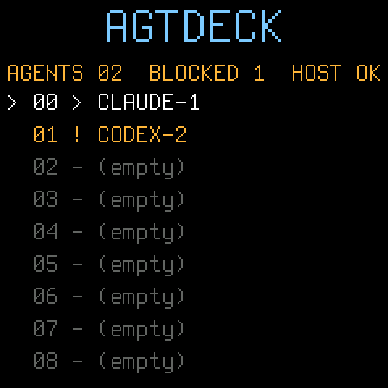

# Agent Deck — an FM-1 control surface for coding agents

Custom firmware for the **M-VAVE FM-1** that turns the little FM synth into a
hardware desk controller for CLI coding agents (Claude Code, Codex, …)
running on your computer.



Your agents get physical presence: their states live on the FM-1's key LEDs
and its 240×240 screen, and the agents that are **blocked waiting on you**
blink until you deal with them. Approve a permission prompt, deny it,
interrupt a runaway agent, or resume one — from the device, without
switching windows.

> **Status (Nov 2026):** built and verified end-to-end *without* hardware.
> The host daemon is live-tested against real tmux sessions and a real
> Herdr server; the firmware runs in Dinghy's host emulator; and a real
> flashable package (`dist/agentdeck-0.1.fwsc`) has been built with the
> JieLi toolchain and validated by the installer's own package loader.
> The author's FM-1 arrives ~early Dec 2026 — first on-hardware flash is
> the only untested step, and the [arrival-day guide](#arrival-day-read-this-before-plugging-anything-in)
> below is the checklist for it.

> ⚠️ **Flashing custom firmware is at your own risk.** The FM-1's flash is
> single-bank; an interrupted write can leave the unit dark until rescued
> via the chip's mask-ROM boot mode. Read the risk notes in the
> arrival-day section before you flash anything — this project or any other.

---

## Quick start (no FM-1 required)

Everything except the final flash can be tried right now:

```sh
git clone https://github.com/kevinelliott/fm-1-agent-deck.git
cd fm-1-agent-deck

# 1. See the daemon work against your own tmux or Herdr sessions:
python3 host/agentdeck.py --backend auto --simulate
#    commands: select N | start | approve | deny | interrupt | prompt TEXT | quit

# 2. Or run the self-test (spins up three throwaway tmux sessions — a fake
#    Claude Code approval prompt, a spinner, an idle shell — and drives the
#    daemon through discovery → state detection → a real approve):
sh host/test_simulate.sh        # writes host/simulate-test.log
```

With a real FM-1 flashed with Agent Deck and plugged in over USB:

```sh
pip install mido python-rtmidi
python3 host/agentdeck.py --backend auto
```

---

## How it works

```
 ┌──────────────────────── FM-1 ────────────────────────┐
 │ Agent Deck firmware (Dinghy fork, firmware/agentdeck.c)│
 │  keys/buttons/knobs ──► panel events                   │
 │  LEDs + screen     ◄── agent states (CC frame stream)  │
 └──────────────┬───────────────────────────────────────┘
                │  USB-MIDI channel 16  (PROTOCOL.md)
 ┌──────────────▼───────────────────────────────────────┐
 │ host/agentdeck.py  (the daemon, on your computer)      │
 │  panel events ──► approve / deny / interrupt / prompt  │
 │  backend states ──► SLOT / DETAIL / META frames        │
 └──────┬───────────────────────────────┬───────────────┘
        │ socket API (newline JSON)      │ tmux CLI
 ┌──────▼───────┐                 ┌──────▼───────┐
 │    Herdr     │                 │     tmux     │
 │ agent-aware: │                 │ heuristics:  │
 │ Idle/Working/│                 │ command +    │
 │ Blocked/Done │                 │ pane content │
 │   natively   │                 │ patterns     │
 └──────────────┘                 └──────────────┘
```

The daemon polls the backend once a second (Herdr events also nudge it),
diffs the roster, and sends only the changes to the FM-1 as small frames:
`SLOT` (one agent's slot/state/kind/name), `DETAIL` (the selected agent's
last output lines), and `META` (agent count, blocked count). The FM-1
replies with a heartbeat once a second; the screen header shows `HOST OK`
while heartbeats flow and `NO HOST` when they stop. Slot assignments are
stable for the life of the daemon process, in backend discovery order,
up to 54 agents (2 pages × 27 keys).

**Why MIDI, and why CCs for data?** The firmware is built on
[Dinghy](#credits), whose platform reserves SysEx for its own firmware
updater — apps never see SysEx messages. So device→host panel events are
plain notes/CCs (following the HYP-1 firmware's remote-mode precedent),
and host→device data rides a framed byte stream over two CCs
(CC 118 = control, CC 119 = data, 7-bit clean). The full wire spec —
frame formats, state enum, versioning — is in **[PROTOCOL.md](PROTOCOL.md)**.

## Controls reference

### Keys and LEDs

Each of the 27 keys is one agent slot on the current page. Press a key to
select that agent. The key's LED shows its state:

| LED | State | Meaning |
|---|---|---|
| off | EMPTY | no agent in this slot |
| glow (dim) | IDLE | agent is waiting for input |
| solid | WORKING | agent is busy |
| blink, 2 Hz | BLOCKED | **agent needs you** — approval or a question |
| fast blink (~6 Hz) | ERROR | agent/backend reported an error |
| solid 2 s → glow | DONE | agent just finished a turn |
| slow pulse, 1 Hz | UNKNOWN | agent present, state unclassified |

Button LEDs echo context too: PLAY lights while the selected agent is
WORKING, REC blinks while the selected agent is BLOCKED, HOME/GLO light
on their pages.

### Buttons and encoders

Actions are executed by the host daemon against the *selected* agent:

| Control | Action |
|---|---|
| **PLAY** | start / resume the selected agent |
| **REC** | approve (answer the agent's pending prompt) |
| **SAVE** | approve — and jump to the APPROVALS page on the device |
| **FX** | deny (sends Esc) |
| **ENV** | interrupt (sends Ctrl-C) |
| **HOME** | GRID page |
| **EDIT** | DETAIL page (selected agent's recent output) |
| **GLO** | APPROVALS page (all BLOCKED agents) |
| **OCT− / OCT+** | previous / next slot page (54 slots total) |
| **SELECT** encoder | move the selection |
| **ALGORITHM** encoder | cycle GRID → DETAIL → APPROVALS |
| **K1** encoder | scroll the DETAIL page's lines |
| other buttons/knobs | forwarded to the host as protocol events; currently unused |

The three screen pages: **GRID** (every agent as a labelled strip with its
state), **DETAIL** (the selected agent plus its last 8 output lines), and
**APPROVALS** (just the agents waiting on you — the page that makes the
device worth having).

---

## The host daemon

`host/agentdeck.py` is a single-file Python 3 program. The core is
standard-library only; real-MIDI mode additionally needs
`mido` + `python-rtmidi`. Simulate mode needs nothing and is the best way
to understand the system: it prints every frame it *would* send to the
FM-1 and takes typed commands (`select`, `start`, `approve`, `deny`,
`interrupt`, `prompt`, `quit`) that do exactly what the physical controls
would do.

### CLI

| Flag | Default | Meaning |
|---|---|---|
| `--backend` | `auto` | `herdr`, `tmux`, or `auto` (Herdr if its socket exists, else tmux) |
| `--simulate` | off | no MIDI; print frames, read commands from stdin |
| `--port` | auto | substring to match the FM-1's MIDI port name |
| `--herdr-socket` | auto | explicit Herdr socket path |
| `--herdr-session` | — | use a named Herdr session's socket |
| `--poll` | 1.0 | backend poll interval, seconds |

A backend that dies or errors is reported once and retried every poll;
it never takes the MIDI loop down.

### Backend: Herdr (preferred)

[Herdr](https://herdr.dev) is a terminal multiplexer built for coding
agents: it detects the agent in each pane and reports its state
(Idle / Working / Blocked / Done) natively, which is exactly what a
status deck wants. The daemon talks to its newline-delimited JSON socket
API at `~/.config/herdr/herdr.sock` (or `$HERDR_SOCKET_PATH`; named
session: `~/.config/herdr/sessions/<NAME>/herdr.sock`).

- Roster from `agent.list` (fallback `pane.list`); states from the native
  `agent_status` field; detail text via `pane.read`.
- Prompts via `agent.prompt` — which Herdr deliberately **refuses for a
  BLOCKED agent** (`agent_blocked`), so the daemon surfaces that instead
  of typing over an approval dialog. For plain shell panes it falls back
  to `pane.send_input`.
- Approve/deny/interrupt via `pane.send_keys` with logical keys
  (`1`+`enter`, `esc`, `ctrl+c`). (`agent.send_keys` only accepts active
  *named* agents; pane-level keys work for every occupant.)
- Start via `agent.start` (`{name, kind, pane_id}`); if an agent already
  occupies the pane, PLAY sends it a `continue` prompt instead.
- A best-effort `events.subscribe` listener nudges the roster on changes;
  the 1 s poll remains authoritative.

**Verified live against Herdr 0.9.5** (2026-11-08, log in
`host/herdr-test.log`): discovery, BLOCKED/IDLE states with detail text,
approve, deny, interrupt, prompt (real and fallback paths), and
`agent.start` were all exercised against a real headless Herdr server
(`herdr server`; never run bare `herdr` for testing — it opens the TUI).
Three protocol facts from that verification are baked into the client:
request IDs must be **strings**, `params` is always sent, and a normal
request connection is **single-use** — the server closes it after
replying, so each request opens a fresh connection.

### Backend: tmux

No Herdr? Plain tmux works too. Panes are discovered with
`tmux list-panes -a`; the agent kind is guessed from
`pane_current_command`, session/window names and banner text; the state
is a heuristic over the pane's recent content:

| Signal | State |
|---|---|
| permission-prompt patterns ("Do you want to proceed?", "❯ 1. Yes", "(y/n)", "Allow…", …) | BLOCKED |
| output changed in the last ~2 s, or a spinner character is on screen | WORKING |
| completion markers ("task complete", "all tests pass", ✓, …) | DONE |
| otherwise | IDLE |

Approve sequences per kind live in `TmuxBackend.APPROVE` (Claude Code:
`1` + Enter; Codex: `y` + Enter; deny = Esc, interrupt = Ctrl-C,
prompt = literal `send-keys` + Enter). Heuristics are necessarily
fuzzier than Herdr's native states — expect the occasional misread when
an agent redraws its UI in an unusual way.

---

## Building the firmware

`firmware/agentdeck.c` is the whole app. `firmware-build/` is a
[Dinghy](https://github.com/zvenson/dinghy) tree with that file dropped
in as the app and its own identity (package **FM-1_96N**, update screen
`AGTDECK`, `STORE_MAGIC` `0x4147444B` — "AGDK"). The app is deliberately
boring C: no audio (the synth engine is gone — this is a controller),
integer math only, redraw-only-what-changed, `platform_poll()` every
loop, settings persisted to flash.

```sh
# one-time setup (Linux x86-64; on a Mac use Docker/WSL per Dinghy's README)
cd firmware-build
tools/get_toolchain.sh                       # JieLi pi32v2 clang -> ~/.jieli/toolchain
git clone --depth 1 --branch AC79NN_SDK_V1.2.1_2023-12-13 \
    https://gitee.com/Jieli-Tech/fw-AC79_AIoT_SDK.git ~/fw-AC79_AIoT_SDK
pip install mido python-rtmidi Pillow

./build.sh --release 0.1                     # -> build/agentdeck-0.1.fwsc

# host emulator test (no device, no toolchain): tests/agentdeck.txt
# injects protocol frames, presses keys/buttons, renders the screen
cc -O2 -Wall -Wno-unused-function -DDINGHY_HOST -DAPP_VER="\"dev\"" \
   -Ifirmware/hal -Ifirmware/src -Ifirmware/gen \
   -o build/host/agentdeck firmware/src/dinghy.c
build/host/agentdeck build/host/agentdeck tests/agentdeck.txt
```

Verified 2026-11-08: the device build passes all of Dinghy's checks
(image 57,364 B of 581,564; RAM 17,728 B of 98,304), the `.fwsc` parses
under the installer's own `load_package` (CRCs OK), and the emulator
output is in `firmware/host-test.log` with the screenshot at
`firmware/screen-grid.png`. One emulator quirk worth knowing: the host
harness stubs `fm1_input_note_edges()` to 0, so the firmware diffs
`fm1_in.notes` levels like Dinghy's own app does — identical behaviour
on real hardware.

## Arrival day (read this before plugging anything in)

The first target unit is a **late-2026 FM-1**: it will almost certainly
carry the **UC25HQ80** flash chip (JEDEC id `0xB36014`), *not* the early
Puya P25Q80 (`0x856014`), and it will likely ship with **stock
firmware V16**.

**Flash-chip check — already handled, verify anyway.** The only flash-ID
gate in the whole stack is on-device: `FL_JEDEC_OK(id)` in
`firmware-build/firmware/hal/fm1_flash_map.h`, used by the app and the
update loader. **Dinghy 0.5 already accepts both chips on the FM-1:**

```c
#define FL_JEDEC_OK(id) ((id) == 0x856014u || (id) == 0xB36014u)
```

so no allowlist change is needed (older Felucca-derived bases saved to
RAM only on UC25HQ80 units — that's the failure this avoids). The
host-side installer `tools/fm1_install.py` performs **no** flash-ID
check at all. If a future Dinghy rebase ever drops the second clause,
that one line is the fix.

**Sequence for the day the unit lands:**

1. Power it on stock first. Check the stock firmware version and enjoy
   the synth briefly — it's a good one.
2. **Return to stock V15 before flashing anything custom.** Community
   guidance and every custom-firmware installer assume V15 as the base:
   use M-VAVE's M-UPGRADE updater (or a browser installer's
   "Return to official V15" option) if it shipped with V16.
3. Flash Agent Deck over USB, using the package in `dist/`:
   `python3 firmware-build/tools/fm1_install.py dist/agentdeck-0.1.fwsc`
   (or the FM-1 Firmware Hub in Chrome/Edge). The installer asks before
   it writes; the FM-1 restarts into Agent Deck.
4. Start the daemon (`--backend auto`), watch the FM-1 screen switch
   from `NO HOST` to `HOST OK`, and tap a few keys.
5. Going back: any installer can return the unit to official V15/V16
   the same way.

**Risk notes.** The FM-1's flash is **single-bank**: an interrupted
write can leave the unit dark. This is recoverable — the JieLi chip's
mask-ROM boot mode (WL82 UBOOT) lives in ROM, not flash, and the
community's FM-1-transporter exists for exactly this; holding **OCT−**
at power-on also forces the USB rescue in Dinghy-derived firmware.
Still: flash on a charged battery / stable USB, and don't unplug
mid-write.

## Troubleshooting

| Symptom | Likely cause / fix |
|---|---|
| Daemon: "no FM-1 MIDI port found" | Unit not plugged in, not flashed with Agent Deck, or another app holds the port. `--port` prints what it sees; check the cable carries data. |
| FM-1 shows `NO HOST` | Daemon not running, or the heartbeat isn't flowing — restart the daemon; check the screen's header after ~2 s. |
| Daemon: "herdr socket not found" | Herdr isn't running. Start it (`herdr server` for headless) or check `--herdr-session` / `$HERDR_SOCKET_PATH`. |
| `agent.prompt: agent_blocked` | Working as designed: Herdr won't inject a prompt while an agent waits on an approval. Approve or deny it from the device (REC / FX) instead. |
| Herdr actions fail after a Herdr upgrade | Socket methods may have been renamed. `herdr api schema --json` is the authority; the daemon surfaces Herdr's error code rather than crashing. |
| tmux agent shows the wrong state | The tmux backend is heuristic (see patterns in `TmuxBackend`). Herdr gives exact states. |
| Settings don't survive power-off on a newer FM-1 | You're on a UC25HQ80 unit with a firmware base that only knows the Puya chip — see the flash-chip section above. Agent Deck's base already handles both. |

## Testing

| Test | Command | Covers |
|---|---|---|
| tmux end-to-end | `sh host/test_simulate.sh` | discovery, BLOCKED/WORKING/IDLE heuristics, approve landing in the pane (`host/simulate-test.log`) |
| Herdr live run | `python3 host/agentdeck.py --backend herdr --simulate` against a running Herdr | native states, detail text, approve/deny/interrupt/prompt/start (`host/herdr-test.log` is a captured run) |
| Firmware emulator | the `cc …` build in [Building](#building-the-firmware) | frame parsing, screen rendering, panel event output (`firmware/host-test.log`) |

## v1 scope limits & roadmap

Limits, honestly:

- **USB-MIDI only.** The protocol is transport-agnostic and BLE MIDI is
  the obvious next step, but Dinghy's BLE path is untested for this use.
- **No text entry on the device.** Typed prompts happen from the
  daemon's CLI; the FM-1's SEQ button is forwarded as a host event but
  has no text-entry mode (27 keys ≠ a keyboard, whatever the synth
  pretends).
- **54 slots max** (2 pages); slots follow backend discovery order.
- **1 s delta updates.** This is a status deck, not a terminal; the
  DETAIL page shows the last 8 captured lines.
- **Herdr backend verified against 0.9.5.** Other versions may rename
  socket methods (see Troubleshooting).

Roadmap ideas, in rough order: first-hardware validation and fixes →
BLE MIDI transport → per-agent cost/token readouts on DETAIL (Herdr
exposes token counters) → using `agent.send_keys` for named agents →
more agent kinds in the tmux heuristics → a small menu-bar/status
companion so the daemon can autostart.

## Files

| Path | What |
|---|---|
| `PROTOCOL.md` | The wire spec (v1) |
| `host/agentdeck.py` | The daemon: Herdr + tmux backends, MIDI + simulate modes |
| `host/test_simulate.sh` | End-to-end simulate test against real tmux panes |
| `host/simulate-test.log` | Latest tmux test run — ALL PASS |
| `host/herdr-test.log` | Live Herdr-backend simulate run (Herdr 0.9.5) |
| `firmware/agentdeck.c` | The firmware app |
| `firmware/host-test.log` | Emulator run of the exact shipped source |
| `firmware/screen-grid.png` | The GRID page as rendered by the emulator |
| `firmware-build/` | Dinghy tree + Agent Deck identity; `./build.sh` here |
| `dist/agentdeck-0.1.fwsc` | The built firmware package, ready to flash |

## Credits

Agent Deck stands on a remarkable few months of FM-1 community work:

- **[Dinghy](https://github.com/zvenson/dinghy)** by zvenson — the
  minimal firmware base: platform, build, installer, host emulator.
- **Felucca** by Leo Kuroshita (Hügelton Instruments) and the **SLOOP**
  port — the platform layer Dinghy carries.
- **HYP-1** — the remote-mode precedent for the panel's MIDI mapping.
- **M-VAVE** — the FM-1 itself, and the official FM1 Open SDK.
- **[Herdr](https://herdr.dev)** — the agent-aware multiplexer whose
  socket API makes the preferred backend possible.

## License

GPL-3.0, inherited from Dinghy/Felucca. See `firmware-build/LICENSE`
and `firmware-build/LICENSING.md`; keep the copyright headers if you
redistribute.
