# Agent Deck — an FM-1 control surface for coding agents


Custom firmware for the **M-VAVE FM-1** that turns the little FM synth into a
hardware desk controller for CLI coding agents (Claude Code, Codex, …)
running on your computer.

*What the animation is: a picture of the FM-1 (White and Blue colorway) with
Agent Deck's screen playing in its display — a visualization, not a
video of the author's unit. The screen content is not a mockup: every
frame is the LCD of firmware 0.6.2, captured from the shipped package
running in [fm1-emu](#see-it-running--fm1-emu) and set into the display
pixel for pixel. The firmware runs on a real FM-1 today; footage of it
has yet to replace this. Each screen is shown full size in
[the tour](#a-tour-of-the-screens) below.*

▶ **[Play Agent Deck live in your browser](https://kevinelliott.github.io/fm-1-agent-deck/play/?fw=agentdeck&script=demo.txt)**
— a firmware package running in **fm1-emu** on this project's own player
page. One click on **Start** and it plays a scripted session by itself:
daemon frames in, the GRID as a list and as boxes, every page walked.
It is the same firmware 0.6.2 package as on the unit. A one-page
**[cheat sheet](https://kevinelliott.github.io/fm-1-agent-deck/cheatsheet.html)**
has the controls.
(Device-only view for embedding elsewhere:
[embed link](https://kevinelliott.github.io/fm-1-agent-deck/play/?fw=agentdeck&script=demo.txt&embed=1).)

## Why an FM synth?

First, appreciate the FM-1 for what it actually is: a genuinely delightful
piece of music gear. For roughly the price of a nice dinner it packs a full
**6-operator FM synthesizer** (32 algorithms, DX-style sounds), a 16-step
sequencer, an arpeggiator, effects, a built-in speaker and a rechargeable
battery into a pocketable box that comes in a stack of cheerful colorways.
It's an instrument you can throw in a bag and play anywhere.

Now look at it with a developer's eyes, and it stops reading as a synth and
starts reading as the control surface the industry forgot to build:

- a **240×240 color screen** — meant for waveforms and preset browsers
- **27 backlit keys** — a piano keyboard, or 27 status lights with buttons
  attached
- **14 more LED buttons**, labelled like a transport: PLAY, REC, SAVE, HOME,
  EDIT…
- **7 endless encoders plus a master pot** — for tweaking FM operators, or
  for scrolling through agents
- **USB-C (MIDI + audio), Bluetooth MIDI and TRS MIDI** — it already speaks
  fluent computer
- and an active custom-firmware community that has made the box hackable

Every one of those music features maps one-to-one onto the job of wrangling
coding agents. The keys become agent slots, their LEDs become agent states.
The transport buttons become *start*, *approve*, *deny* and *interrupt*. The
screen that was browsing piano presets now shows which agents are working,
which are idle — and which one is **blocked, waiting on you**, blinking until
you deal with it. Even the mindset carries over: running a fleet of agents
*is* a performance — a row of voices, each needing a cue at the right moment.

So Agent Deck takes a music product and re-casts it in the developer world.
The synth engine steps aside (this firmware is a pure controller, and
flashing back to stock brings the instrument right back) and the FM-1 gets a
second life on the desk next to your keyboard: not making sound, but giving
your agents a physical presence you can see and touch without switching
windows.

Your agents get physical presence: their states live on the FM-1's key LEDs
and its 240×240 screen, and the agents that are **blocked waiting on you**
blink until you deal with them. Approve a permission prompt, deny it,
interrupt a runaway agent, or resume one — from the device, without
switching windows. Or go further: answer an agent's menu with two knobs,
fire a canned prompt at it, put it on auto-approve, start a new agent on an
empty key, hold REC and tap every blinking key to clear a row of approvals,
and let the deck chime when someone needs you.

> **Status (Nov 2026):** running on real hardware. **Firmware 0.6.2**
> (protocol v6), the newest package (`dist/agentdeck-0.6.2.fwsc`), is
> installed on the author's FM-1 — flashed over USB with the installer in
> this repo, as every release from 0.1 on was before it — and driven
> there by the daemon against a live Herdr session. Every package is
> built with the JieLi toolchain and booted in
> [fm1-emu](https://github.com/joakimeriksson/fm1-emu), the chip-level
> FM-1 emulator, before it goes anywhere near the unit.
> Still young: the features have had far more emulator and simulate-mode
> time than hours on the desk — the prompt queue, pipelines and
> auto-approve rules have so far been exercised against a stub backend
> rather than long sessions with real agents — so expect rough edges. The
> [arrival-day guide](#arrival-day-read-this-before-plugging-anything-in)
> is the checklist for a first flash.

> **Coming from another firmware:** Agent Deck is a controller with no
> projects, patches or samples of its own, and it does not read any other
> firmware's. It keeps only its own few settings in flash. Whether another
> firmware's saved projects survive a visit to Agent Deck has not been
> tested, so back them up first.

> ⚠️ **Flashing custom firmware is at your own risk.** The FM-1's flash is
> single-bank; an interrupted write can leave the unit dark until rescued
> via the chip's mask-ROM boot mode. Read the risk notes in the
> arrival-day section before you flash anything — this project or any other.

---

## A tour of the screens

Colour means state everywhere: **amber** is waiting on you, **green** is
finished, **red** is broken, **white** is working, **grey** is at rest.
Every image here is the LCD of `dist/agentdeck-0.6.2.fwsc` running in
fm1-emu, fed the frames the daemon sends; the fleet of eight agents is
made up for the pictures, the pixels are not.
[`tools/emu_shots.py`](tools/emu_shots.py) regenerates all of them.

**Starting up.** A splash at power-on, then the deck waits for its
daemon. Once the host is there and no agents are running, it says what
to do next.

| Power-on | No daemon yet | Host connected, no agents |
|---|---|---|
| 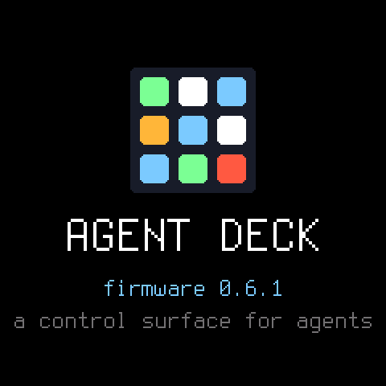 | 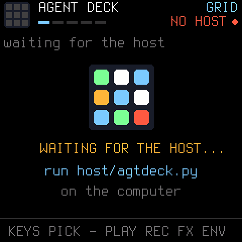 | 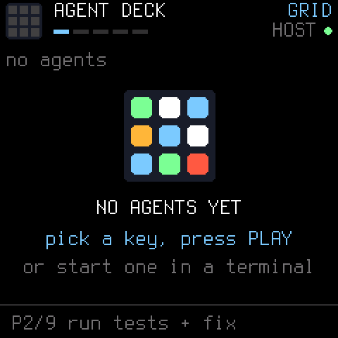 |

**GRID** — the fleet. The header carries a logo whose nine pads are the
first nine slots in their state colours, the page name, a five-segment
page indicator, a host light, and a chip per state with its count. Each
row is a state-coloured edge, the slot number, a state icon, the name, a
kind tag (`CL` Claude Code, `CX` Codex, `OC` opencode, `GK` Grok, `CP`
Copilot, `SH` a shell), time in state, flags (`A` auto-approve, `R`
repeat, `+` marked, `Q` prompt queued) and a context gauge. The bottom
line is the footer: the armed prompt preset, or — tinted — whatever just
happened. Press HOME again and the same fleet becomes boxes.

| The list | An agent calls for you | The same fleet as boxes |
|---|---|---|
| 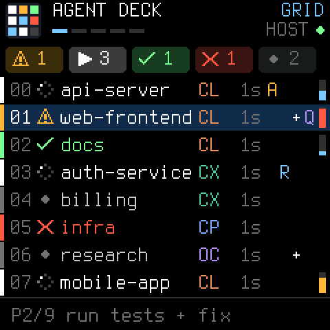 | 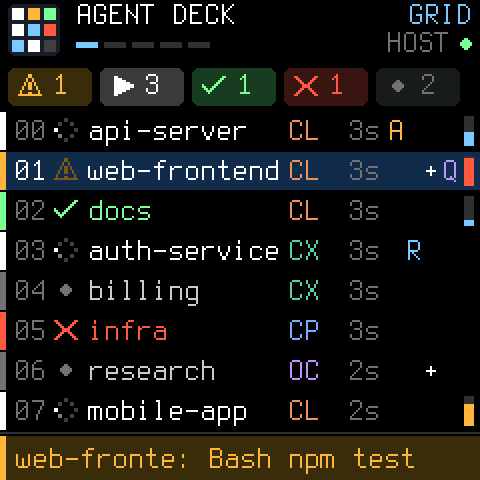 | 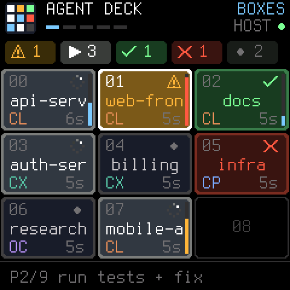 |

**Boxes** resize with the deck: big tiles with the full name for a few
agents, down to all 27 keys of the page at once, where each tile is the
slot number and a state icon. Free keys are outlines.

| Up to 4 agents | Up to 16 | A full page of 27 |
|---|---|---|
| 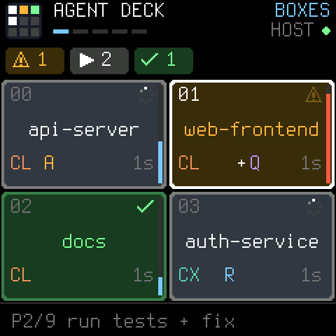 | 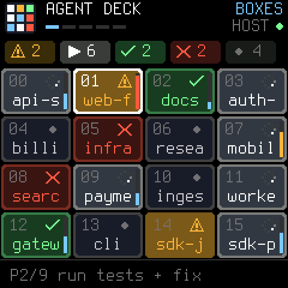 | 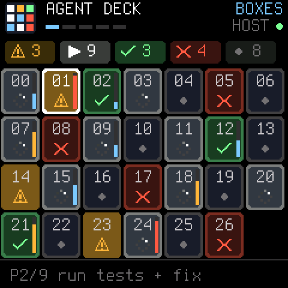 |

**DETAIL** — one agent. The state as a pill, time in state, flags, the
kind, a context bar, then six lines of text. EDIT cycles what the text
is: the agent's own **OUTPUT**, the daemon's **INFO** summary, and the
**DIFF** against the last commit.

| OUTPUT | INFO | DIFF |
|---|---|---|
| 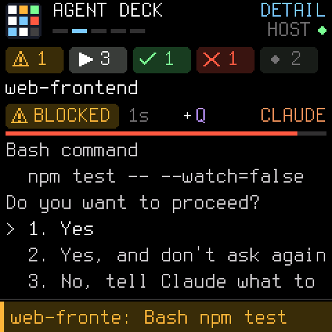 | 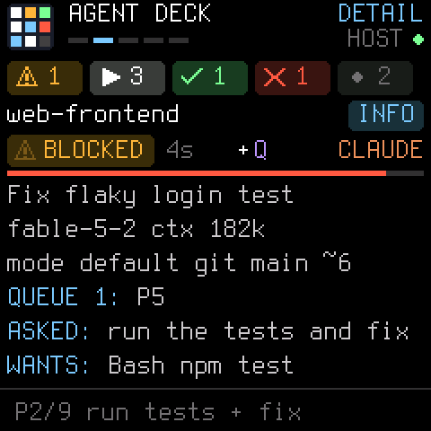 | 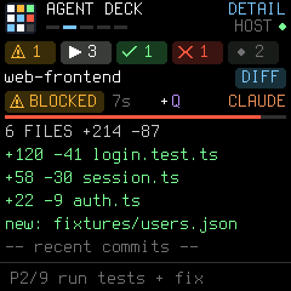 |

**APPROVALS and ABOUT.** APPROVALS lists only the agents waiting on you —
the page that makes the device worth having — and says so when the list
is empty. ABOUT is the device describing itself and its host.

| Waiting on you | Nobody waiting | ABOUT |
|---|---|---|
| 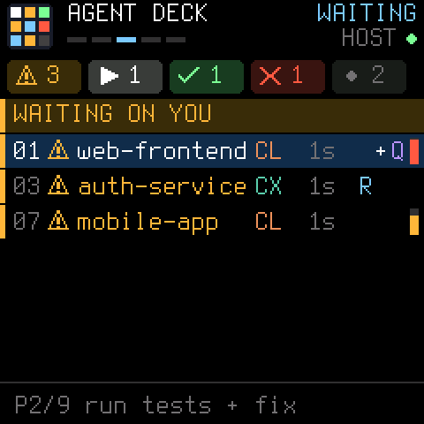 | 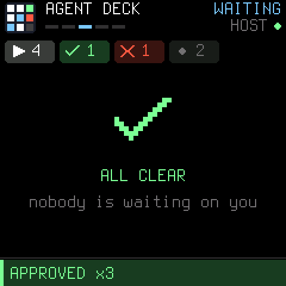 | 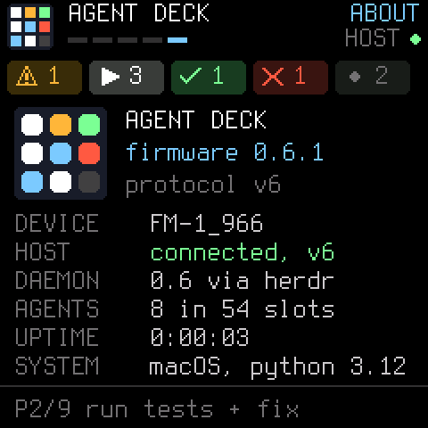 |

**MENU** is drawn by the daemon, so it grows without a firmware update:
SELECT moves, SEL picks, FX backs out.

| Top level | THIS AGENT | FLEET | SETTINGS |
|---|---|---|---|
| 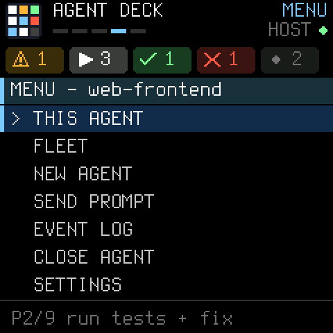 | 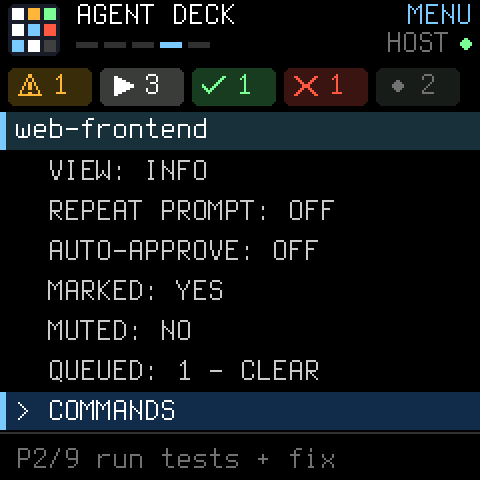 | 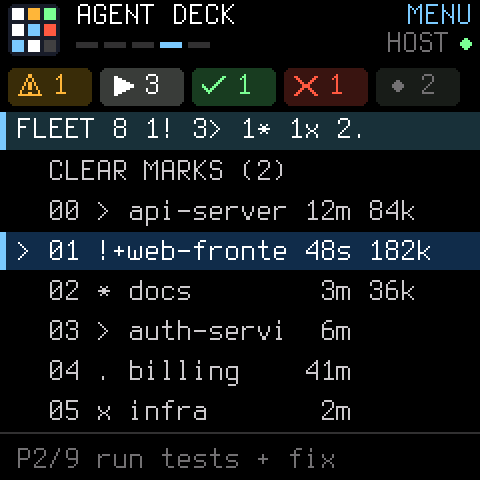 | 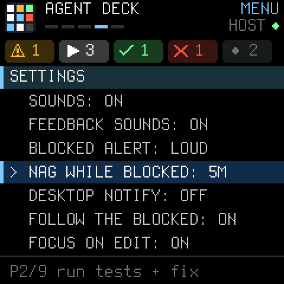 |

What the screenshots cannot show: the key LEDs, which carry the same
states (see [Keys and LEDs](#keys-and-leds)), the icons' motion — the
spinner turns, the warning sign blinks, a blocked tile pulses — and the
sounds.

---

## See it running — fm1-emu

No FM-1 on your desk? Agent Deck is
developed and tested against **[fm1-emu](https://github.com/joakimeriksson/fm1-emu)**,
Joakim Eriksson's emulator for the FM-1: it emulates the JieLi AC791N
chip itself (both CPU cores, screen, keys, encoders, MIDI), so firmware
packages run in it *unchanged* — the same `.fwsc` you would flash.

The screens in [the tour](#a-tour-of-the-screens) come from there: the
LCD of `dist/agentdeck-0.6.2.fwsc` booted in fm1-emu and fed the frame
stream the daemon sends (injected through the FM-1's MIDI IN jack, which
the firmware's platform merges into the same queue as USB MIDI). Two
scripts drive it:

- [`tools/emu_test.py`](tools/emu_test.py) is the **test**: one session
  on the packaged firmware — boot, a full resync, the ALGORITHM encoder
  turned through all five pages, HOME for the boxes — that fails on a
  CPU halt, a dead LCD or a blank page.
- [`tools/emu_shots.py`](tools/emu_shots.py) is the **camera**: one
  short emulator run per scene (start-up, GRID, boxes, DETAIL,
  APPROVALS, MENU, ABOUT), saving the `docs/shot-*.png` images, then
  playing sixteen of them in the display of the FM-1 picture to make
  the animation at the top of this page (`docs/intro.gif`).

**Run it yourself, in the browser:** this project hosts its own
fm1-emu player (a vendored copy of the emulator whose only firmware
is Agent Deck — see [`docs/play/`](docs/play/README.md)):
**[kevinelliott.github.io/fm-1-agent-deck/play/?fw=agentdeck&script=demo.txt](https://kevinelliott.github.io/fm-1-agent-deck/play/?fw=agentdeck&script=demo.txt)**.
One click on **Start** (browsers hold back sound until a click; the
emulator's audio thread is what starts it) and it plays a scripted
session by itself; afterwards the panel is yours — click the keys, turn
the ALGORITHM knob, open the picker. A plain visit (no `script=`)
boots the deck to `NO HOST`: it is a controller, and it wants its
daemon. The player carries the current package (0.6.2); the session is
written by `python3 tools/emu_shots.py --player`.

**Embed it on a site:** the player supports fm1-emu's embed mode —
this iframe windows just the device, auto-playing the demo:

```html
<iframe src="https://kevinelliott.github.io/fm-1-agent-deck/play/?fw=agentdeck&script=demo.txt&embed=1"
        width="480" height="640" style="border:0"
        title="Agent Deck running in fm1-emu"></iframe>
```

(Adjust the size to taste. GitHub renders no iframes in READMEs, which
is why this page carries captures and a link instead.) You can also run the deck on the upstream
[fm1-emu page](https://joakimeriksson.github.io/fm1-emu/): download
[`dist/agentdeck-0.6.2.fwsc`](dist/agentdeck-0.6.2.fwsc), choose
**Open .fwsc…** there, and press **Start**.

**Run it natively:** `tools/get_emu.sh` fetches the fm1-emu release
binary, and `fm1-live` (included) opens the emulated FM-1 in a window —
screen, panel, audio, and every MIDI input of your computer.

One honest limit: in the emulator the deck has no live daemon behind it,
so what you see is the panel, the pages and the protocol working against
canned frames — for the full loop, pair the daemon with tmux/Herdr in
`--simulate` mode (below), or flash a real one. The
player above is self-hosted because the upstream fm1-emu page only
deep-links (`?fw=`) firmwares in its own catalog; a listing on the
[FM-1 Firmware Hub](https://thefirmwarehub.com/) would put Agent Deck
in that catalog too. Up to 0.6.1 that was not possible: the packages
identified as `FM-1_96N`, numbers other firmwares on the Hub already
use. Firmware 0.6.2 has an identity of its own and the repository now
carries what the Hub asks for (`fmhub.json`, a card picture, a root
`LICENSE`); the submission itself has not been made yet, and the Hub
lists firmwares that make music, so a coding-agent controller may not
qualify.

---

## Quick start (no FM-1 required)

Everything except the final flash can be tried right now:

```sh
git clone https://github.com/kevinelliott/fm-1-agent-deck.git
cd fm-1-agent-deck

# 1. See the daemon work against your own tmux or Herdr sessions:
python3 host/agentdeck.py --backend auto --simulate
#    (it prints its command list: select N | approve | deny | send | spawn | ...)

# 2. Or run the self-test (spins up three throwaway tmux sessions — a fake
#    Claude Code approval prompt, a spinner, an idle shell — and drives the
#    daemon through discovery → state detection → a real approve):
sh host/test_simulate.sh        # writes host/simulate-test.log

# 3. Or boot the real firmware package on the emulated FM-1 chip and
#    watch the deck itself work (fm1-emu; see "See it running" above):
sh tools/get_emu.sh             # one-time: fetch the fm1-emu binary
python3 tools/emu_test.py       # boots the newest dist/*.fwsc, injects daemon
                                # frames, walks the pages, snapshots the LCD
python3 tools/emu_shots.py --out build/shots   # every screen in the tour
```

With a real FM-1 flashed with Agent Deck and plugged in over USB:

```sh
pip install mido python-rtmidi
python3 host/agentdeck.py --backend auto
```

---

## How it works

```
 ┌──────────────────────── FM-1 ────────────────────────┐
 │ Agent Deck firmware (Dinghy fork, firmware/agentdeck.c)│
 │  keys/buttons/knobs ──► panel events                   │
 │  LEDs + screen     ◄── agent states (CC frame stream)  │
 └──────────────┬───────────────────────────────────────┘
                │  USB-MIDI channel 16  (PROTOCOL.md)
 ┌──────────────▼───────────────────────────────────────┐
 │ host/agentdeck.py  (the daemon, on your computer)      │
 │  panel events ──► approve / deny / interrupt / prompt  │
 │  backend states ──► SLOT / DETAIL / META frames        │
 └──────┬───────────────────────────────┬───────────────┘
        │ socket API (newline JSON)      │ tmux CLI
 ┌──────▼───────┐                 ┌──────▼───────┐
 │    Herdr     │                 │     tmux     │
 │ agent-aware: │                 │ heuristics:  │
 │ Idle/Working/│                 │ command +    │
 │ Blocked/Done │                 │ pane content │
 │   natively   │                 │ patterns     │
 └──────────────┘                 └──────────────┘
```

The daemon polls the backend once a second (Herdr events also nudge it),
diffs the roster, and sends only the changes to the FM-1 as small frames:
`SLOT` (one agent's slot/state/kind/name), `DETAIL` (the selected agent's
output lines), `META` (agent count, blocked count), `FOOTER` (the status
line) and `BEEP` (a chime). The FM-1
replies with a heartbeat once a second; the screen header shows `HOST OK`
while heartbeats flow and `NO HOST` when they stop. Slot assignments are
stable for the life of the daemon process, in backend discovery order,
up to 54 agents (2 pages × 27 keys).

**Why MIDI, and why CCs for data?** The firmware is built on
[Dinghy](#credits), whose platform reserves SysEx for its own firmware
updater — apps never see SysEx messages. So device→host panel events are
plain notes/CCs (following the HYP-1 firmware's remote-mode precedent),
and host→device data rides a framed byte stream over two CCs
(CC 118 = control, CC 119 = data, 7-bit clean). The full wire spec —
frame formats, state enum, versioning — is in **[PROTOCOL.md](PROTOCOL.md)**.

## Controls reference

### Keys and LEDs

Each of the 27 keys is one agent slot on the current page. Press a key to
select that agent. The key's LED shows its state:

| LED | State | Meaning |
|---|---|---|
| off | EMPTY | no agent in this slot |
| glow (dim) | IDLE | agent is waiting for input |
| solid | WORKING | agent is busy |
| blink, 2 Hz | BLOCKED | **agent needs you** — approval or a question |
| fast blink (~6 Hz) | ERROR | agent/backend reported an error |
| solid 2 s → glow | DONE | agent just finished a turn |
| slow pulse, 1 Hz | UNKNOWN | agent present, state unclassified |

Button LEDs echo context too: PLAY lights while the selected agent is
WORKING, REC blinks while the selected agent is BLOCKED, ARP lights while
it is on auto-approve, HOME/EDIT/GLO light on their pages.

### Buttons and encoders

Actions are executed by the host daemon against the *selected* agent:

| Control | Action |
|---|---|
| **Keys** | select a slot (empty ones too) |
| **SELECT** encoder | move the selection across agents |
| **PLAY** | start / continue; on a bare shell, start the default agent in it; on an **empty slot**, spawn a new agent there (`default_agent`, in a new Herdr workspace / tmux window) |
| **REC** | approve the pending prompt |
| **SAVE** | approve *and don't ask again* — picks the prompt's "Yes, and don't ask again / allow all…" option when one is on screen; otherwise does nothing and says so |
| **FX** | deny (Esc) |
| **ENV** | interrupt (Ctrl-C) |
| **SEL** | Enter |
| **K2** / **K3** encoders | Up·Down / Left·Right arrow keys — with SEL, enough to answer any menu an agent shows |
| **LFO** | cycle the agent's mode (Shift+Tab). Lit while the selected agent is marked (firmware 0.4) |
| **PRESETS** encoder | arm a prompt preset (shown on the footer line) |
| **SEQ** | send the armed preset as a prompt. To a BLOCKED agent it is **queued** instead and goes out once the agent is free (the row shows `Q`, firmware 0.6) |
| **ARP** | toggle auto-approve for this agent (row shows `A`, ARP lights); the daemon then approves its prompts as they appear. Off by default, forgotten when the daemon restarts |
| **K1** encoder | scroll DETAIL back through the agent's output; on the MENU page, move a page at a time |
| **K4** encoder | jump to the next agent that needs you (BLOCKED, then ERROR, then DONE) |
| **EDIT** | DETAIL page — and focus that pane on the computer. Pressed again on DETAIL: cycle **OUTPUT**, **INFO** and **DIFF** (below) |
| **HOME** / **GLO** | GRID page / APPROVALS page. HOME pressed again on the GRID flips it between the **list** and the **boxes** (firmware 0.6). GLO pressed again on APPROVALS jumps to the agent that has waited longest (the oldest BLOCKED, else an ERROR, else a DONE) |
| **ALGORITHM** encoder | cycle GRID → DETAIL → APPROVALS → MENU → ABOUT |
| **OCT− / OCT+** | previous / next slot page (54 slots total) |
| **GLO held +** REC / FX / ENV / SEQ / ARP | the same for *every* agent it applies to: approve or deny all BLOCKED, interrupt all WORKING, send the preset to all IDLE/DONE, auto-approve off everywhere. **While any agents are marked, the same buttons act on the marked ones only**, and GLO + LFO clears the marks |
| **MASTER** | chime volume |

**Chords** (firmware 0.3) — hold a button and tap keys; the cursor stays
where it is, and while the button is held the keys light up to show what
a tap would hit:

| Chord | Action |
|---|---|
| **REC + key** | approve *that* agent (blocked ones blink) |
| **FX + key** | deny that agent |
| **ENV + key** | interrupt that agent (working ones blink) |
| **SEQ + key N** | send prompt preset N to the selected agent |
| **SEL + key N** | answer option N — types the digit 1–9. When the prompt on screen has numbered choices, exactly those keys light (the "don't ask again" one blinks) and the footer names the one you picked |
| **PLAY + key** | start / continue that agent; on an empty key, spawn one there |
| **SAVE + key** | move the selected agent to that key (a swap if it is taken) |
| **LFO + key** | **mark / unmark** that agent (marked keys light). Marks make a group: GLO + REC / FX / ENV / SEQ then acts on just those agents. The row shows `+` (firmware 0.5) |
| **ARP + key** | toggle auto-approve on that agent (keys on auto light) |
| **SEQ held ~1 s** | **repeat mode**: send the armed prompt to this agent every time it finishes a turn, up to `repeat_max` times. The row shows `R` and SEQ stays lit; hold SEQ again to stop |

**Knobs with a button held** (firmware 0.3):

| Combo | Action |
|---|---|
| **PLAY held + PRESETS** | choose which agent PLAY starts (cycles the installed CLIs) |
| **SEQ held + PRESETS** | how many times repeat mode sends (`repeat_max`) |
| **SEL held + K1** | scroll DETAIL a page at a time |
| **LFO held + K4** | step through the marked agents |

A chord button tapped on its own still does its normal thing (on release).

**The MENU page** (firmware 0.3; ALGORITHM turns to it) is drawn by the
daemon: SELECT moves, SEL picks, FX backs out.

| Entry | What it does |
|---|---|
| THIS AGENT | view, repeat mode, auto-approve, mark, mute (no sounds or alerts from this one), its prompt queue (clear it), **COMMANDS** (`/compact`, `/clear`, `/context`… from `commands`), focus on the computer, copy its last reply to the clipboard, open its folder |
| FLEET | every agent on one screen — state, time in state, context size — with the counts in the title; pick a row to open that agent's DETAIL. Also MARK ALL / CLEAR MARKS |
| NEW AGENT | pick an installed agent CLI and a directory (the current agents' directories plus `projects` from the config) and start it. `IN A NEW WORKTREE: YES` first makes a git worktree next to the repository (`<repo>-wt1` on branch `deck/wt1`, and so on) and starts the agent there |
| SEND PROMPT | `IF WORKING:` send now or queue it; `AGAIN:` what the agent was last asked (Claude Code), then the preset list; pick one to send to the selected agent |
| EVENT LOG | who got blocked, finished, was approved or closed, and how long ago |
| CLOSE AGENT | close the selected agent's pane, after a yes/no |
| SETTINGS | sounds, feedback sounds, how loud the BLOCKED alert is, nag while blocked (alert again every 2 / 5 / 10 min), desktop notifications, follow the blocked (the selection jumps to an agent when it blocks), focus-on-EDIT, auto-approve off everywhere, resync the device |
| HELP | the control list above, on the device |
| ABOUT | the ABOUT page (firmware 0.6; a text version on older firmware) |

**The screen** (firmware 0.6) is shown page by page in
[the tour](#a-tour-of-the-screens). In short:

- **Colour is state:** amber is waiting on you, green is finished, red
  is broken, white is working, grey is at rest.
- The **header** has the live nine-pad logo, the page name and page
  indicator, a host light, and a chip per state with its count.
- A **GRID row** is a state-coloured edge, the slot number, a state icon
  (a spinner while working, a blinking warning sign while blocked, a
  tick, a cross), the name, a two-letter kind tag in the agent's colour
  (`CL` `CX` `OC` `GK` `CP` `SH`), time in state, the flags (`A` auto,
  `R` repeat, `+` marked, `Q` queue) and the context gauge. The selected
  row is a highlighted band.
- **GRID as boxes** (HOME again on the GRID; remembered across power
  cycles): a tile per agent, filled in its state's colour — amber and
  pulsing while it waits on you, green when finished, red when broken —
  with its name, icon, kind, time in state and, up its right edge, the
  context gauge (along the bottom edge in 0.6, where it ran through the
  tile's last line of text; 0.6.1 moved it). The tiles resize with the
  deck: four big ones for a few agents, down to all 27 keys of the page
  at once; free keys are outlines.
- **DETAIL** shows the state as a pill, the kind, the context bar and a
  tag for the INFO / DIFF views; the text is coloured by what it is
  (`LABEL:` prefixes, added lines green, prompts white).
- **APPROVALS** shows a large tick and ALL CLEAR when nobody is waiting.
- An empty deck shows the logo and what to do next; a power-on splash
  shows the logo and firmware version; footer messages get a tinted band.
- **ABOUT** (the fifth page, or MENU → ABOUT): firmware and protocol
  version, the package identity, whether a host is connected and which
  protocol it speaks, the daemon's version and backend, agents in use,
  uptime, and the computer's OS and Python.

**The prompt queue.** Each agent has one. A prompt sent to a BLOCKED
agent waits in it (answer the agent first; the prompt follows by itself),
and with `"queue_when_working": true` so does a prompt sent mid-turn. A
preset can also be a **pipeline** — `{"label": "test > review > commit",
"steps": [...]}` — whose steps go out one per finished turn; the queue
pauses while the agent is BLOCKED or in ERROR. INFO lists what is queued,
and MENU → THIS AGENT clears it.

**Auto-approve has limits.** Before ARP's auto-approve answers a prompt,
the daemon checks what the agent wants to run, and the prompt on screen,
against `auto_never` — by default `rm -r`/`-f`, `git push`,
`git reset --hard`, `sudo`, `--force`, `drop table`, `mkfs`/`dd`. On a
match it does not answer: the deck sounds the alert and says
`AUTO HELD api: YOU DECIDE`. It is a pattern match on text, not a
sandbox — a risky command phrased another way gets through — so keep
auto-approve for agents whose worst case you can live with.

**The INFO view** of DETAIL (firmware 0.3+) answers "what is this one
doing?" without reading its scrollback. For Claude Code agents the daemon
reads the session's own log under `~/.claude/projects/` (read-only, tail
only, best effort — it is an internal format):

```
Fix flaky login test          <- the session's title
fable-5-2 ctx 70k             <- model, context in use
mode default git main ~6      <- permission mode; branch, changed files
ASKED: run the tests and fix
WANTS: Bash npm test          <- what a blocked agent is waiting to run
TODO 3/7: Updating the mocks
SAID: The failure is in...
```

A blocked agent's numbered choices are listed too (`SEL+2: Yes, and
don't ask again`), and `CONTEXT 71% FULL` once the size is known.

**The DIFF view** is the third stop of EDIT: what the agent has changed
in its repository since the last commit — `8 FILES +864 -417`, then a
line per file, largest first, untracked files, and the last three
commits. K1 scrolls it.

**Context gauges** (firmware 0.5): each Claude Code agent's row ends in a
small bar that fills as its context does (blue, amber from 60%, red from
85%), and DETAIL draws it under the status line. Once an agent crosses
`ctx_warn_pct` the deck says so once (`api CONTEXT 82%`) — time for
MENU → THIS AGENT → COMMANDS → `/compact`.

The same log names the reason when an agent blocks, so the footer says
`api: Bash npm test` instead of just `api NEEDS YOU`. Other agent kinds
get the git line only. SAVE blinks when the prompt on screen offers a
"don't ask again" option (firmware 0.4).

Slots are remembered across daemon restarts
(`~/.config/agentdeck/slots.json`), so an agent keeps its key.

The bottom line of every page is the **footer**: the armed prompt preset
(`P2/8 run tests + fix`), or for a few seconds the result of what you just
did (`APPROVED api-server`) or an agent calling for you (`docs NEEDS YOU`).
The deck also makes **sounds** through the FM-1's own output, at the
MASTER volume (`"sounds": false` turns them all off):

| Sound | When |
|---|---|
| the **alert** — three rising calls, three times, about twice as loud as anything else | an agent becomes BLOCKED (and each nag). `"alert": "normal"` swaps it for the short two-call chime |
| a soft C-E-G | an agent finished |
| two low notes | an agent errored |
| a quiet double note | an agent's context is getting full |
| a soft rising / falling blip | you approved, started or sent something / denied or stopped something |
| a faint tick | a menu move or pick, a preset armed, a mark, a view change |

The last two rows are the feedback sounds (`"ui_sounds": false` silences
just those). The alert, the feedback sounds and the per-sound loudness
need **firmware 0.5**; on older firmware a BLOCKED agent gets the
attention chime three times in a row instead, and the feedback sounds
stay silent.
Each GRID row shows how long the agent has been in its state.

**Which firmware has what.** The daemon works with every firmware
release and leaves out what an older one cannot show; everything not
listed here works on all of them (on firmware 0.1 and 0.2 the chord
buttons act at once, on press).

| Firmware | Adds |
|---|---|
| 0.2 | the footer, chimes, K1 / K4, the auto-approve marker |
| 0.3 | chords and knob combos (a held button), the MENU page, the INFO toggle |
| 0.4 | the `R` marker, lit SEQ / LFO, blinking SAVE |
| 0.5 | the `+` marker, context gauges, the alert and feedback sounds, per-sound loudness |
| 0.6 | the colour screens, the box view, the ABOUT page, the `Q` marker, the INFO / DIFF tag on DETAIL |
| 0.6.1 | the box view's context gauge on the tile's right edge |
| 0.6.2 | no new controls: its own package identity (`FM-1_2435N`) and USB name (`FM-1 AGTDECK`) |

The five screen pages, in ALGORITHM order: **GRID** (every agent, as a
list or as boxes), **DETAIL** (the selected agent plus six lines of its
output, its INFO or its DIFF), **APPROVALS** (just the agents waiting on
you), **MENU** and **ABOUT**.

---

## The host daemon

`host/agentdeck.py` is a single-file Python 3 program. The core is
standard-library only; real-MIDI mode additionally needs
`mido` + `python-rtmidi`. Simulate mode needs nothing and is the best way
to understand the system: it prints every frame it *would* send to the
FM-1 and takes typed commands (`select`, `start`, `approve`, `always`,
`deny`, `interrupt`, `send`, `prompt`, `spawn`, … — it prints the list at
startup) that do exactly what the physical controls would do; `btn NAME`
and `enc NAME N` replay a panel control as the FM-1 would send it.

### CLI

| Flag | Default | Meaning |
|---|---|---|
| `--backend` | `auto` | `herdr`, `tmux`, or `auto` (Herdr if its socket exists, else tmux) |
| `--simulate` | off | no MIDI; print frames, read commands from stdin |
| `--port` | auto | substring to match the FM-1's MIDI port name |
| `--herdr-socket` | auto | explicit Herdr socket path |
| `--herdr-session` | — | use a named Herdr session's socket |
| `--poll` | 1.0 | backend poll interval, seconds |
| `--config` | `~/.config/agentdeck/config.json` if present | JSON config, see below |

### Config

Optional. Copy [`host/config.example.json`](host/config.example.json) to
`~/.config/agentdeck/config.json` (or pass `--config`); anything left out
keeps its default.

| Key | Default | Meaning |
|---|---|---|
| `presets` | 9 built-ins (`continue`, run tests + fix, summarize, review changes, commit, explain blocker, the test > review > commit pipeline, `/compact`, `/clear`) | the prompts PRESETS arms and SEQ sends: a string, `{"label": …, "text": …}`, or a pipeline `{"label": …, "steps": [ … ]}` |
| `default_agent` | `claude` | what PLAY starts on an empty slot |
| `agents` | `claude`, `codex`, `opencode`, `grok`, `copilot` | shell command per agent kind (add flags here) |
| `spawn_cwd` | `null` | where a spawned agent starts; `null` = the selected agent's directory |
| `projects` | `[]` | extra directories offered by MENU → NEW AGENT |
| `queue_when_working` | `false` | hold a prompt for a WORKING agent until its turn is over, instead of sending it mid-turn |
| `auto_never` | see above | regular expressions (case-insensitive); auto-approve leaves a matching prompt to you. `[]` turns the check off |
| `follow` | `false` | move the selection to an agent when it blocks |
| `repeat_max` | `10` | repeat mode stops by itself after this many sends |
| `nag_minutes` | `0` | chime again every N minutes while an agent stays BLOCKED (0 = off) |
| `open_cmd` | `open` (macOS) / `xdg-open` | what MENU → THIS AGENT → OPEN FOLDER runs |
| `commands` | `/compact`, `/clear`, `/context`, `/review`, `/status` | what MENU → THIS AGENT → COMMANDS offers; typed at the agent as they are |
| `ctx_window` | `200000` | tokens that count as a full context for the gauge (a session seen above this is taken to have a 1M window) |
| `ctx_warn_pct` | `80` | warn once when an agent's context passes this percentage (0 = never) |
| `notify` | `false` | also post a desktop notification when an agent blocks, finishes or errors |
| `sounds` | `true` | all sounds |
| `ui_sounds` | `true` | the quiet feedback sounds (firmware 0.5) |
| `alert` | `"loud"` | how a BLOCKED agent announces itself: `"loud"` or `"normal"` |
| `focus_on_edit` | `true` | EDIT also focuses the pane on the computer |

A backend that dies or errors is reported once and retried every poll;
it never takes the MIDI loop down.

### Backend: Herdr (preferred)

[Herdr](https://herdr.dev) is a terminal multiplexer built for coding
agents: it detects the agent in each pane and reports its state
(Idle / Working / Blocked / Done) natively, which is exactly what a
status deck wants. The daemon talks to its newline-delimited JSON socket
API at `~/.config/herdr/herdr.sock` (or `$HERDR_SOCKET_PATH`; named
session: `~/.config/herdr/sessions/<NAME>/herdr.sock`).

- Roster from `agent.list` (fallback `pane.list`); states from the native
  `agent_status` field; detail text via `pane.read`.
- Prompts via `agent.prompt` — which Herdr deliberately **refuses for a
  BLOCKED agent** (`agent_blocked`), so the daemon surfaces that instead
  of typing over an approval dialog. For plain shell panes it falls back
  to `pane.send_input`.
- Approve/deny/interrupt via `pane.send_keys` with logical keys
  (`1`+`enter`, `esc`, `ctrl+c`). (`agent.send_keys` only accepts active
  *named* agents; pane-level keys work for every occupant.)
- Start via `agent.start` (`{name, kind, pane_id}`); if an agent already
  occupies the pane, PLAY sends it a `continue` prompt instead.
- A best-effort `events.subscribe` listener nudges the roster on changes;
  the 1 s poll remains authoritative.

**Verified live against Herdr 0.9.5** (2026-11-08, log in
`host/herdr-test.log`): discovery, BLOCKED/IDLE states with detail text,
approve, deny, interrupt, prompt (real and fallback paths), and
`agent.start` were all exercised against a real headless Herdr server
(`herdr server`; never run bare `herdr` for testing — it opens the TUI).
Three protocol facts from that verification are baked into the client:
request IDs must be **strings**, `params` is always sent, and a normal
request connection is **single-use** — the server closes it after
replying, so each request opens a fresh connection.

### Backend: tmux

No Herdr? Plain tmux works too. Panes are discovered with
`tmux list-panes -a`; the agent kind is guessed from
`pane_current_command`, session/window names and banner text; the state
is a heuristic over the pane's recent content:

| Signal | State |
|---|---|
| permission-prompt patterns ("Do you want to proceed?", "❯ 1. Yes", "(y/n)", "Allow…", …) | BLOCKED |
| output changed in the last ~2 s, or a spinner character is on screen | WORKING |
| completion markers ("task complete", "all tests pass", ✓, …) | DONE |
| otherwise | IDLE |

Approve sequences per kind live in `TmuxBackend.APPROVE` (Claude Code:
`1` + Enter; Codex: `y` + Enter; deny = Esc, interrupt = Ctrl-C,
prompt = literal `send-keys` + Enter). Heuristics are necessarily
fuzzier than Herdr's native states — expect the occasional misread when
an agent redraws its UI in an unusual way.

---

## Building the firmware

`firmware/agentdeck.c` is the whole app. `firmware-build/` is a
[Dinghy](https://github.com/zvenson/dinghy) tree with that file dropped
in as the app and its own identity (package **FM-1_2435N**, where N is
the minor version — 0.6.2 is `FM-1_24356`; USB name `FM-1 AGTDECK`;
update screen `AGTDECK`, `STORE_MAGIC` `0x4147444B` — "AGDK"). The app is deliberately
boring C: no audio (the synth engine is gone — this is a controller),
integer math only, redraw-only-what-changed, `platform_poll()` every
loop, settings persisted to flash.

```sh
# one-time setup (Linux x86-64; on a Mac use Docker/WSL per Dinghy's README)
cd firmware-build
tools/get_toolchain.sh                       # JieLi pi32v2 clang -> ~/.jieli/toolchain
git clone --depth 1 --branch AC79NN_SDK_V1.2.1_2023-12-13 \
    https://gitee.com/Jieli-Tech/fw-AC79_AIoT_SDK.git ~/fw-AC79_AIoT_SDK
pip install mido python-rtmidi Pillow

./build.sh --release 0.6.2                   # -> build/agentdeck-0.6.2.fwsc

# host emulator test (no device, no toolchain): tests/agentdeck.txt
# (generated by tools/gen_host_test.py; on macOS add '-Dsection(x)=' to cc)
# injects protocol frames, presses keys/buttons, renders the screen
cc -O2 -Wall -Wno-unused-function -DDINGHY_HOST -DAPP_VER="\"dev\"" \
   -Ifirmware/hal -Ifirmware/src -Ifirmware/gen \
   -o build/host/agentdeck firmware/src/dinghy.c
build/host/agentdeck build/host/agentdeck tests/agentdeck.txt

# on-device test (the packaged .fwsc on the emulated chip, via fm1-emu):
# run this on the package you actually ship, after every release build
sh tools/get_emu.sh                          # one-time
python3 tools/emu_test.py                    # -> build/emu-test/*.png
python3 tools/emu_shots.py                   # -> docs/shot-*.png, docs/intro.gif
```

`tools/emu_shots.py` is slow: each of its eight scenes is its own
emulator run, a couple of minutes of CPU apiece on the author's Mac.
Name scenes to redo just those (`tools/emu_shots.py grid about`);
`--intro-only` rebuilds the animation from the shots already there.

Verified 2026-11-08 (firmware 0.1): the device build passes all of
Dinghy's checks, the `.fwsc` parses under the installer's own
`load_package` (CRCs OK), and the emulator output is in
`firmware/host-test.log`. As of 0.6.2 (2026-11-13) the build still
passes those checks at 65,292 B of 581,564 for the image and 18,432 B
of 98,304 of RAM. One emulator quirk worth knowing: the host
harness stubs `fm1_input_note_edges()` to 0, so the firmware diffs
`fm1_in.notes` levels like Dinghy's own app does — identical behaviour
on real hardware.

Verified 2026-11-09: the same packaged `.fwsc` boots in **fm1-emu**
(0.4.0) on the emulated AC791N and runs a full scripted session to
completion with no CPU halt — accepting the daemon's frame stream
injected through the MIDI IN jack and rendering all its pages; the
session is reproducible with `tools/emu_test.py`, and every package
since has been through it. That makes fm1-emu the
project's on-device test stand-in: the host harness above stays the
fast inner loop for logic, but anything that touches boot, screen,
panel or protocol is only "tested" once it has run as a package in
fm1-emu.

## Arrival day (read this before plugging anything in)

This section was written before the author's unit arrived, as the plan
for its first flash. That unit has since been flashed over USB with
step 3 below — every release from 0.1 to 0.6.2 — and runs Agent Deck
today. The plan stays here as the checklist for anyone else's first
flash.

A **late-2026 FM-1** will most likely carry the **UC25HQ80** flash chip
(JEDEC id `0xB36014`), *not* the early Puya P25Q80 (`0x856014`), and
ship with **stock firmware V16**.

**Flash-chip check — already handled, verify anyway.** The only flash-ID
gate in the whole stack is on-device: `FL_JEDEC_OK(id)` in
`firmware-build/firmware/hal/fm1_flash_map.h`, used by the app and the
update loader. **Dinghy 0.5 already accepts both chips on the FM-1:**

```c
#define FL_JEDEC_OK(id) ((id) == 0x856014u || (id) == 0xB36014u)
```

so no allowlist change is needed (older Felucca-derived bases saved to
RAM only on UC25HQ80 units — that's the failure this avoids). The
host-side installer `tools/fm1_install.py` performs **no** flash-ID
check at all. If a future Dinghy rebase ever drops the second clause,
that one line is the fix.

**Sequence for the day the unit lands:**

0. Already done for you: the exact package in `dist/` has been booted
   and driven in fm1-emu (see [See it running](#see-it-running--fm1-emu)),
   so what follows is confirming the real hardware behaves like the
   emulated chip — repeat the `tools/emu_test.py` session by hand:
   frames in, ALGORITHM through the pages, screens checked.
1. Power it on stock first. Check the stock firmware version and enjoy
   the synth briefly — it's a good one.
2. **Return to stock V15 before flashing anything custom.** Community
   guidance and every custom-firmware installer assume V15 as the base:
   use M-VAVE's M-UPGRADE updater (or a browser installer's
   "Return to official V15" option) if it shipped with V16.
3. Flash Agent Deck over USB, using the package in `dist/`:
   `python3 firmware-build/tools/fm1_install.py dist/agentdeck-0.6.2.fwsc`
   (or the FM-1 Firmware Hub in Chrome/Edge). The installer asks before
   it writes; the FM-1 restarts into Agent Deck.
4. Start the daemon (`--backend auto`), watch the FM-1 screen switch
   from `NO HOST` to `HOST OK`, and tap a few keys.
5. Going back: any installer can return the unit to official V15/V16
   the same way.

**Risk notes.** The FM-1's flash is **single-bank**: an interrupted
write can leave the unit dark. This is recoverable — the JieLi chip's
mask-ROM boot mode (WL82 UBOOT) lives in ROM, not flash, and the
community's FM-1-transporter exists for exactly this; holding **OCT−**
at power-on also forces the USB rescue in Dinghy-derived firmware.
Still: flash on a charged battery / stable USB, and don't unplug
mid-write.

## Troubleshooting

| Symptom | Likely cause / fix |
|---|---|
| Daemon: "no FM-1 MIDI port found" | Unit not plugged in, not flashed with Agent Deck, or another app holds the port. `--port` prints what it sees; check the cable carries data. |
| The MIDI port is still called `Felucca` after updating to 0.6.2 | Releases up to 0.6.1 used the platform's USB name, and macOS remembers a MIDI device's name. The unit itself reports `FM-1 AGTDECK` (see System Information → USB); the daemon and installer find it under either name. To refresh the name, unplug the FM-1, delete the greyed-out device in Audio MIDI Setup → MIDI Studio, and plug it back in. |
| FM-1 shows `NO HOST` | Daemon not running, or the heartbeat isn't flowing — restart the daemon; check the screen's header after ~2 s. |
| Daemon: "herdr socket not found" | Herdr isn't running. Start it (`herdr server` for headless) or check `--herdr-session` / `$HERDR_SOCKET_PATH`. |
| `agent.prompt: agent_blocked` | Working as designed: Herdr won't inject a prompt while an agent waits on an approval. Approve or deny it from the device (REC / FX) instead. |
| Herdr actions fail after a Herdr upgrade | Socket methods may have been renamed. `herdr api schema --json` is the authority; the daemon surfaces Herdr's error code rather than crashing. |
| tmux agent shows the wrong state | The tmux backend is heuristic (see patterns in `TmuxBackend`). Herdr gives exact states. |
| Settings don't survive power-off on a newer FM-1 | You're on a UC25HQ80 unit with a firmware base that only knows the Puya chip — see the flash-chip section above. Agent Deck's base already handles both. |

## Testing

**Rule of the house: a test that needs a device runs in fm1-emu.**
Dinghy's host harness compiles the app natively and stubs the hardware
— fast, and right for logic — but it cannot catch a package that won't
boot, a screen drawn wrong on the real LCD path, or a protocol break.
fm1-emu runs the shipped `.fwsc` on the emulated chip, so the packaged
firmware is what gets tested. On arrival day the same `emu_test.py`
session (frames in, pages walked, screens checked) is the script whose
steps get repeated on the real unit.

| Test | Command | Covers |
|---|---|---|
| **fm1-emu device test** | `python3 tools/emu_test.py` (after `tools/get_emu.sh`) | the packaged `.fwsc` booting on the emulated AC791N, daemon frame stream in via MIDI IN, all five pages and the box view rendering, ALGORITHM page walk; LCD snapshots in `build/emu-test/` |
| fm1-emu screenshots | `python3 tools/emu_shots.py` | not a pass/fail test of behaviour: one emulator run per scene, failing only on a crash or a blank screen. Its output is the tour above, which is where a drawing mistake gets seen |
| tmux end-to-end | `sh host/test_simulate.sh` | discovery, BLOCKED/WORKING/IDLE heuristics, approve landing in the pane (`host/simulate-test.log`) |
| Herdr live run | `python3 host/agentdeck.py --backend herdr --simulate` against a running Herdr | native states, detail text, approve/deny/interrupt/prompt/start (`host/herdr-test.log` is a captured run) |
| Firmware host harness | the `cc …` build in [Building](#building-the-firmware) | frame parsing, screen rendering, panel event output (`firmware/host-test.log`) — fast inner loop; not a substitute for the fm1-emu run |

## Scope limits & roadmap

Limits, honestly:

- **USB-MIDI only.** The protocol is transport-agnostic and BLE MIDI is
  the obvious next step, but Dinghy's BLE path is untested for this use.
- **No text entry on the device.** SEQ sends one of your prompt presets
  (PRESETS picks); free-form prompts are typed at the agent itself
  (27 keys ≠ a keyboard, whatever the synth pretends).
- **54 slots max** (2 pages); a new agent takes the first free slot (or
  the empty one you pressed PLAY on) and keeps it across daemon restarts.
- **1 s delta updates.** This is a status deck, not a terminal; the
  DETAIL page shows 6 wrapped lines at a time (K1 scrolls back ~200
  terminal lines).
- **Herdr backend verified against 0.9.5.** Other versions may rename
  socket methods (see Troubleshooting).

Roadmap ideas, in rough order: more hours on real hardware, and fixes →
Firmware Hub listing (the Hub requires a package tested on real
hardware; listing unlocks fm1-emu's one-click `?fw=` browser link from
this README) → BLE MIDI transport → per-agent cost/token readouts on
DETAIL (Herdr exposes token counters) → using `agent.send_keys` for
named agents → more agent kinds in the tmux heuristics → a small
menu-bar/status companion so the daemon can autostart.

## Files

| Path | What |
|---|---|
| `PROTOCOL.md` | The wire spec (v6) |
| `LICENSE` | GPL-3.0 |
| `fmhub.json` · `docs/card.png` | The card text, links and picture for [The Firmware Hub](https://thefirmwarehub.com/) |
| `docs/cheatsheet.html` | The controls on one page, served by GitHub Pages |
| `host/agentdeck.py` | The daemon: Herdr + tmux backends, MIDI + simulate modes |
| `host/test_simulate.sh` | End-to-end simulate test against real tmux panes |
| `host/simulate-test.log` | Latest tmux test run — ALL PASS |
| `host/herdr-test.log` | Live Herdr-backend simulate run (Herdr 0.9.5) |
| `firmware/agentdeck.c` | The firmware app |
| `firmware/host-test.log` | Emulator run of the exact shipped source |
| `firmware/screen-grid.png` | The GRID page as rendered by the host harness |
| `tools/emu_test.py` | fm1-emu device test: boots the packaged `.fwsc`, injects daemon frames, walks the pages, snapshots the LCD |
| `tools/get_emu.sh` | Fetches the fm1-emu release binary into `tools/fm1-emu-bin/` |
| `tools/emu_shots.py` | The screenshots: one fm1-emu run per scene on the packaged `.fwsc`, writing `docs/shot-*.png` and `docs/intro.gif` |
| `docs/shot-*.png` | The 19 screens of [the tour](#a-tour-of-the-screens), as rendered by the packaged firmware in fm1-emu |
| `docs/intro.gif` | The animation at the top of this README: sixteen of those screens playing in the display of the FM-1 picture |
| `docs/play/` | The self-hosted live player: vendored fm1-emu (MIT) + Agent Deck catalog + the auto-play demo script, served by GitHub Pages |
| `docs/fm1-agent-deck-hero.jpg` | The FM-1 picture (White and Blue) the animation is built on, with the GRID page in its display |
| `firmware-build/` | Dinghy tree + Agent Deck identity; `./build.sh` here |
| `dist/agentdeck-0.6.2.fwsc` | The built firmware package, ready to flash, and the one installed on the author's FM-1 (`-0.6.1` … `-0.1`: earlier releases) |
| `host/config.example.json` | Example daemon config (prompt presets, default agent) |
| `tools/gen_host_test.py` | Generates the host-harness session `firmware-build/tests/agentdeck.txt` |

## Credits

Agent Deck stands on a remarkable few months of FM-1 community work:

- **[Dinghy](https://github.com/zvenson/dinghy)** by zvenson — the
  minimal firmware base: platform, build, installer, host emulator.
- **[fm1-emu](https://github.com/joakimeriksson/fm1-emu)** by Joakim
  Eriksson — the chip-level FM-1 emulator this project tests its
  packaged firmware in, and the reason you can run the deck in a
  browser before any hardware exists.
- **Felucca** by Leo Kuroshita (Hügelton Instruments) and the **SLOOP**
  port — the platform layer Dinghy carries.
- **HYP-1** — the remote-mode precedent for the panel's MIDI mapping.
- **M-VAVE** — the FM-1 itself, and the official FM1 Open SDK.
- **[Herdr](https://herdr.dev)** — the agent-aware multiplexer whose
  socket API makes the preferred backend possible.

## License

GPL-3.0, inherited from Dinghy/Felucca. See `LICENSE`
and `firmware-build/LICENSING.md`; keep the copyright headers if you
redistribute.
